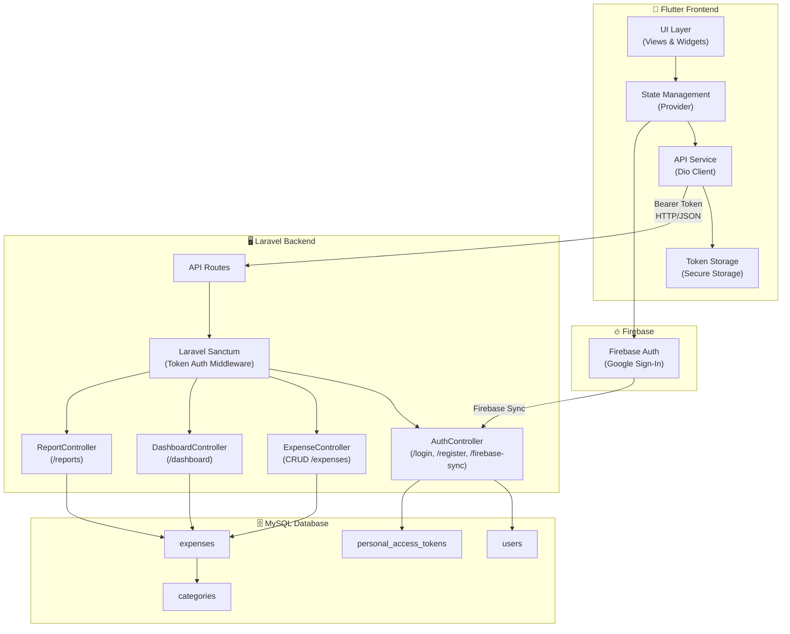
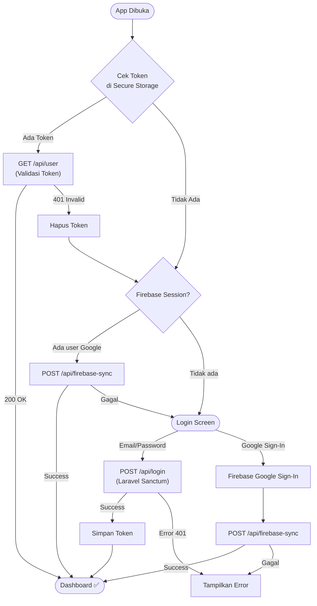

<div align="center">


# 🐷 Spendly

**Aplikasi manajemen keuangan pribadi yang cantik dan intuitif**

[](https://flutter.dev)
[](https://dart.dev)
[](https://laravel.com)
[](https://www.mysql.com)
[](https://firebase.google.com)
[](LICENSE)

**Status:** 🟢 Active Development &nbsp;|&nbsp; **Version:** 1.0.0

---

*Developed by* **[Alifah Ghina S](https://github.com/seira-14)**

</div>

---

## 📖 Tentang Spendly

**Spendly** adalah aplikasi manajemen keuangan pribadi berbasis mobile yang dirancang untuk membantu pengguna mencatat, mengategorikan, dan menganalisis pengeluaran sehari-hari secara mudah dan menyenangkan.

### Masalah yang Diselesaikan
Banyak orang kesulitan memantau ke mana uang mereka pergi setiap bulan. Spendly hadir sebagai solusi sederhana namun powerful: pencatatan pengeluaran yang cepat, visualisasi data yang intuitif, dan laporan yang mudah dipahami.

### Target Pengguna
- Mahasiswa dan karyawan muda yang ingin mengelola keuangan pribadi
- Siapa saja yang ingin memiliki kontrol lebih baik atas pengeluaran bulanan mereka

---

## ✨ Fitur Utama

| Fitur | Deskripsi |
|-------|-----------|
| 🔐 **Autentikasi** | Login email/password via Laravel Sanctum + Google Sign-In via Firebase |
| 📊 **Dashboard** | Ringkasan pengeluaran bulanan, donut chart kategori, transaksi terbaru |
| 💸 **Manajemen Pengeluaran** | Tambah, edit, hapus transaksi dengan kategori dan catatan |
| 📋 **Riwayat** | Riwayat lengkap dengan filter bulan, kategori, dan pencarian |
| 📈 **Laporan Analitik** | Bar chart harian, tren bulanan, perbandingan bulan sebelumnya |
| 👤 **Profil** | Edit profil, upload foto atau pilih avatar animasi preset |
| 🌐 **Multi-platform** | Support Android, iOS, Web, dan Desktop |

---

## 🛠️ Technology Stack

### Frontend (Flutter)
| Teknologi | Versi | Kegunaan |
|-----------|-------|----------|
| Flutter | 3.44.5 | UI framework cross-platform |
| Dart | 3.12.2 | Bahasa pemrograman |
| Provider | ^6.1.2 | State management |
| Dio | ^5.7.0 | HTTP client untuk API calls |
| Flutter Secure Storage | ^9.2.2 | Penyimpanan token Sanctum yang aman |
| Shared Preferences | ^2.3.2 | Preferensi pengguna (server IP, last email) |
| Firebase Core | ^3.12.1 | Firebase initialization |
| Firebase Auth | ^5.5.1 | Google Sign-In authentication |
| Google Sign-In | ^6.2.2 | Google OAuth flow |
| FL Chart | ^0.69.0 | Donut chart & bar chart |
| Google Fonts | ^6.2.1 | Outfit font family |
| Image Picker | ^1.2.3 | Upload foto profil dari galeri |
| Intl | ^0.19.0 | Format tanggal dan mata uang |

### Backend (Laravel)
| Teknologi | Versi | Kegunaan |
|-----------|-------|----------|
| Laravel | ^12.0 | PHP web framework (REST API) |
| Laravel Sanctum | ^4.3 | Token-based API authentication |
| PHP | ^8.2 | Server-side language |
| MySQL | 8.0 | Relational database |

---

## 🏗️ Arsitektur Sistem



### Authentication Flow



---

## 📁 Struktur Project

```
spendly/
├── 📂 backend/                     # Laravel REST API
│   ├── app/
│   │   ├── Http/Controllers/
│   │   │   ├── AuthController.php      # Login, Register, Firebase Sync, Profile
│   │   │   ├── DashboardController.php # Monthly summary + category breakdown
│   │   │   ├── ExpenseController.php   # CRUD operations for expenses
│   │   │   ├── ReportController.php    # Analytics: daily/monthly trends
│   │   │   └── CategoryController.php  # List expense categories
│   │   └── Models/
│   │       ├── User.php                # User model (HasApiTokens)
│   │       ├── Expense.php             # Expense model (BelongsTo User, Category)
│   │       └── Category.php            # Category model
│   ├── database/migrations/            # Database schema migrations
│   ├── routes/api.php                  # API route definitions + throttling
│   └── .env.example                    # Environment variables template
│
├── 📂 frontend/                    # Flutter Application
│   ├── lib/
│   │   ├── main.dart                   # App entry point + SplashScreenWrapper
│   │   ├── firebase_options.dart       # Firebase platform configuration
│   │   ├── core/
│   │   │   ├── constants/
│   │   │   │   ├── api_constants.dart  # Base URL, endpoints, timeouts
│   │   │   │   └── app_colors.dart     # Design system colors
│   │   │   ├── network/
│   │   │   │   ├── dio_client.dart     # Singleton Dio HTTP client
│   │   │   │   └── token_storage.dart  # Secure token read/write/delete
│   │   │   └── utils/
│   │   │       ├── currency_formatter.dart
│   │   │       └── date_formatter.dart
│   │   ├── models/                     # Data models (fromJson / toJson)
│   │   │   ├── user_model.dart
│   │   │   ├── expense_model.dart
│   │   │   ├── category_model.dart
│   │   │   ├── dashboard_model.dart
│   │   │   └── report_model.dart
│   │   ├── providers/                  # ChangeNotifier state management
│   │   │   ├── auth_provider.dart      # Auth state, login, logout, session
│   │   │   ├── expense_provider.dart
│   │   │   ├── dashboard_provider.dart
│   │   │   ├── report_provider.dart
│   │   │   └── category_provider.dart
│   │   ├── services/
│   │   │   ├── api_service.dart        # All API calls via Dio
│   │   │   └── firebase_auth_service.dart # Firebase + Google Sign-In
│   │   ├── views/
│   │   │   ├── auth/
│   │   │   │   ├── login_screen.dart
│   │   │   │   ├── register_screen.dart
│   │   │   │   └── forgot_password_screen.dart
│   │   │   ├── dashboard/
│   │   │   │   ├── dashboard_screen.dart
│   │   │   │   └── widgets/            # BalanceCard, DonutChart, etc.
│   │   │   ├── expense/
│   │   │   │   ├── add_expense_screen.dart
│   │   │   │   ├── edit_expense_screen.dart
│   │   │   │   └── expense_detail_modal.dart
│   │   │   ├── history/
│   │   │   │   └── history_screen.dart
│   │   │   ├── reports/
│   │   │   │   └── report_screen.dart
│   │   │   └── profile/
│   │   │       ├── profile_screen.dart
│   │   │       └── avatar_picker_sheet.dart
│   │   └── widgets/
│   │       ├── app_avatar.dart          # Reusable avatar widget
│   │       └── google_sign_in_button.dart
│   └── assets/images/                  # App images
│
├── 📂 docs/                        # Documentation
│   ├── screenshots/                    # App screenshots (PNG)
│   └── SCREENSHOT_GUIDE.md             # Screenshot capture instructions
│
├── run_backend.bat                 # Quick-start backend (Windows)
├── run_frontend.bat                # Quick-start frontend (Windows)
├── LICENSE                         # MIT License
└── README.md                       # This file
```

---

## 🚀 Instalasi & Setup

### Prasyarat

Pastikan software berikut sudah terinstall:

| Software | Versi Minimum | Link |
|----------|--------------|------|
| Flutter | 3.44.5+ | [flutter.dev](https://flutter.dev/docs/get-started/install) |
| Dart SDK | 3.12.2+ | (bundled with Flutter) |
| PHP | 8.2+ | [php.net](https://www.php.net/downloads) |
| Composer | 2.x | [getcomposer.org](https://getcomposer.org) |
| MySQL | 8.0+ | [mysql.com](https://dev.mysql.com/downloads/) |
| Node.js | 18+ | [nodejs.org](https://nodejs.org) |
| Git | Any | [git-scm.com](https://git-scm.com) |

---

### 1. Clone Repository

```bash
git clone https://github.com/seira-14/spendly.git
cd spendly
```

---

### 2. Setup Backend (Laravel)

```bash
cd backend
```

#### a. Install PHP dependencies
```bash
composer install
```

#### b. Configure environment
```bash
# Copy environment template
cp .env.example .env

# Generate application key
php artisan key:generate
```

Edit `.env` dengan konfigurasi database Anda:
```env
APP_NAME=Spendly
APP_URL=http://localhost:8000

DB_CONNECTION=mysql
DB_HOST=127.0.0.1
DB_PORT=3306
DB_DATABASE=spendly_db
DB_USERNAME=root
DB_PASSWORD=your_password
```

#### c. Create database
```sql
-- Di MySQL client atau phpMyAdmin:
CREATE DATABASE spendly_db CHARACTER SET utf8mb4 COLLATE utf8mb4_unicode_ci;
```

#### d. Run migrations
```bash
php artisan migrate
```

#### e. Start backend server
```bash
# Development (accessible from local network)
php artisan serve --host=0.0.0.0 --port=8000

# Or use the included batch file (Windows):
# Double-click run_backend.bat from the root folder
```

Backend akan berjalan di: `http://localhost:8000/api`

---

### 3. Setup Frontend (Flutter)

```bash
cd ../frontend
```

#### a. Install Flutter dependencies
```bash
flutter pub get
```

#### b. Configure server IP

**Jika menggunakan emulator Android / iOS Simulator / Web:**
> Tidak perlu konfigurasi tambahan. App otomatis terhubung ke `http://127.0.0.1:8000/api`.

**Jika menggunakan HP fisik (Android):**

Edit `lib/core/constants/api_constants.dart`:
```dart
static const String defaultAndroidLanIp = '192.168.x.x'; // Ganti dengan IP Wi-Fi PC Anda
```

Atau gunakan pengaturan server in-app:
> Login screen → tombol "Pengaturan Server Backend" → masukkan IP Anda

Cari IP Wi-Fi PC Anda:
```bash
# Windows
ipconfig | findstr "IPv4"

# macOS / Linux
ifconfig | grep inet
```

#### c. Firebase Setup

> **Catatan:** Firebase digunakan untuk Google Sign-In. Jika hanya ingin menggunakan login email/password, langkah ini bisa dilewati — pastikan `firebase_options.dart` tetap ada.

Untuk setup Firebase sendiri:
1. Buat project di [Firebase Console](https://console.firebase.google.com)
2. Aktifkan Authentication → Google Sign-In
3. Download dan replace `google-services.json` (Android) dan `GoogleService-Info.plist` (iOS)
4. Update `lib/firebase_options.dart` dengan config project Anda

#### d. Run the application

```bash
# Web (paling mudah untuk testing)
flutter run -d chrome

# Android emulator
flutter run -d android

# Specific device
flutter devices          # List available devices
flutter run -d <device-id>

# Or use the included batch file (Windows):
# Double-click run_frontend.bat from the root folder
```

---

### 4. Quick Start (Windows)

Untuk kemudahan, project sudah menyertakan batch scripts. Buka **dua terminal terpisah**:

**Terminal 1 — Backend:**
```
Double-click: run_backend.bat
```

**Terminal 2 — Frontend:**
```
Double-click: run_frontend.bat
```

---

## 📱 Screenshots & Dokumentasi Halaman

> 📸 **Note:** Screenshot diambil dari aplikasi yang berjalan dengan data demo.

---

### 1. 🔐 Login Screen


**Deskripsi:** Halaman autentikasi utama Spendly.

**Fitur:**
- Login email & password langsung ke backend Laravel (Sanctum)
- Validasi format email dan minimum 6 karakter password
- Tombol "Masuk Sekarang" di-disable saat proses loading (mencegah double-submit)
- Google Sign-In via Firebase OAuth
- Link ke halaman Lupa Sandi
- Link ke halaman Registrasi
- Pengaturan server backend (berguna untuk testing di HP fisik)

**Navigation:** Sukses login → Dashboard

---

### 2. 📝 Register Screen


**Deskripsi:** Halaman pembuatan akun baru.

**Fitur:**
- Input nama lengkap, email, password, dan konfirmasi password
- Validasi semua field (email format, password match, minimum 6 chars)
- Registrasi langsung ke backend Laravel
- Token Sanctum disimpan otomatis setelah registrasi berhasil

**Navigation:** Sukses daftar → Dashboard | Ada akun? → Login

---

### 3. 🔑 Forgot Password Screen


**Deskripsi:** Reset kata sandi melalui email.

**Fitur:**
- Input email untuk menerima link reset password
- Reset dikirim melalui Firebase Authentication
- Konfirmasi sukses dengan pesan di UI

---

### 4. 🏠 Dashboard Screen


**Deskripsi:** Halaman utama yang menampilkan ringkasan keuangan bulanan.

**Fitur:**
- **Balance Card:** Total pengeluaran bulan ini dengan toggle tampilkan/sembunyikan nominal
- **Donut Chart:** Visualisasi distribusi pengeluaran per kategori
- **Category Cards:** Kartu horizontal scrollable untuk setiap kategori
- **Recent Transactions:** 5 transaksi terakhir dengan nama, kategori, dan jumlah
- **Month Navigator:** Navigasi bulan/tahun untuk melihat data historis

**API:** `GET /api/dashboard?month=&year=`

---

### 5. 📋 Transaction History Screen


**Deskripsi:** Riwayat lengkap semua transaksi pengeluaran.

**Fitur:**
- Filter berdasarkan bulan dan tahun
- Filter berdasarkan kategori (chips horizontal)
- Pencarian berdasarkan judul atau catatan transaksi
- Total pengeluaran dari hasil filter
- Tap item untuk melihat detail lengkap

**API:** `GET /api/expenses?month=&year=&category_id=&search=`

---

### 6. ➕ Add Expense Screen


**Deskripsi:** Form penambahan transaksi pengeluaran baru.

**Fitur:**
- Pemilihan kategori (grid icon dengan label)
- Judul transaksi
- Nominal (format Rupiah)
- Tanggal transaksi (date picker)
- Catatan opsional
- Validasi semua field wajib sebelum submit

**API:** `POST /api/expenses`

---

### 7. ✏️ Edit Expense Screen


**Deskripsi:** Form edit transaksi yang sudah ada.

**Fitur:** Sama dengan Add Expense namun data sudah terisi dari transaksi yang dipilih.

**API:** `PUT /api/expenses/{id}`

---

### 8. 🔍 Expense Detail Modal


**Deskripsi:** Bottom sheet yang menampilkan detail lengkap transaksi.

**Fitur:**
- Icon dan warna kategori
- Judul, catatan, tanggal, dan nominal
- Tombol Edit → Edit Expense screen
- Tombol Hapus dengan dialog konfirmasi

**API:** `DELETE /api/expenses/{id}`

---

### 9. 📊 Analytics Report Screen


**Deskripsi:** Laporan analitik mendalam tentang pola pengeluaran.

**Fitur:**
- **Bar Chart:** Pengeluaran harian selama bulan yang dipilih
- **Perbandingan Bulan:** Total bulan ini vs bulan lalu + persentase perubahan
- **Rata-rata Harian:** Rata-rata pengeluaran per hari
- **Transaksi Tertinggi:** Transaksi dengan nominal terbesar di bulan tersebut
- **Category Breakdown:** Distribusi pengeluaran per kategori dengan persentase
- **Monthly Trend:** Grafik tren pengeluaran Jan-Des

**API:** `GET /api/reports?month=&year=`

---

### 10. 👤 Profile Screen


**Deskripsi:** Halaman profil dan pengaturan akun pengguna.

**Fitur:**
- Tampilan avatar (foto upload, preset animasi, atau inisial nama)
- Nama dan email pengguna
- Edit nama, email, dan password
- Pilih avatar animasi preset
- Upload foto profil dari galeri
- Hapus/reset avatar ke inisial
- Tombol Logout (menghapus token dan kembali ke Login)

**API:** `GET /api/user`, `PUT /api/user`, `POST /api/user/avatar`

---

### 11. 🎨 Avatar Picker Sheet


**Deskripsi:** Bottom sheet untuk memilih avatar animasi preset.

**Fitur:**
- Grid avatar animasi dengan berbagai gaya karakter
- Opsi upload foto dari galeri
- Opsi hapus avatar (kembali ke inisial nama)

---

## 🌐 API Documentation

**Base URL:** `http://<your-server-ip>:8000/api`

**Authentication:** Bearer Token (Laravel Sanctum)
```
Authorization: Bearer <token>
```

### Public Endpoints (No Auth Required)

| Method | Endpoint | Description |
|--------|----------|-------------|
| `POST` | `/login` | Login dengan email & password |
| `POST` | `/register` | Registrasi akun baru |
| `POST` | `/firebase-sync` | Sinkronisasi akun Firebase/Google |
| `GET` | `/categories` | Daftar semua kategori |

**Rate Limiting:** Login & firebase-sync: 10 req/menit | Register: 5 req/menit

#### POST /login
```json
// Request
{
  "email": "user@example.com",
  "password": "password123"
}

// Response 200
{
  "status": "success",
  "message": "Login berhasil!",
  "data": {
    "user": { "id": 1, "name": "...", "email": "...", "avatar": null },
    "token": "1|abc123..."
  }
}

// Response 401
{
  "status": "error",
  "message": "Email atau password salah."
}
```

#### POST /register
```json
// Request
{
  "name": "Alifah",
  "email": "alifah@example.com",
  "password": "password123"
}

// Response 201
{
  "status": "success",
  "message": "Registrasi berhasil!",
  "data": { "user": { ... }, "token": "2|xyz456..." }
}
```

### Protected Endpoints (Bearer Token Required)

| Method | Endpoint | Description |
|--------|----------|-------------|
| `GET` | `/user` | Get authenticated user profile |
| `PUT` | `/user` | Update user profile |
| `POST` | `/user/avatar` | Upload profile photo |
| `POST` | `/logout` | Logout & revoke token |
| `GET` | `/dashboard` | Monthly financial summary |
| `GET` | `/expenses` | List expenses (with filters) |
| `POST` | `/expenses` | Create new expense |
| `GET` | `/expenses/{id}` | Get expense detail |
| `PUT` | `/expenses/{id}` | Update expense |
| `DELETE` | `/expenses/{id}` | Delete expense |
| `GET` | `/reports` | Analytics report |

#### GET /dashboard
```
Query: ?month=11&year=2026
```
```json
{
  "status": "success",
  "data": {
    "user": { "id": 1, "name": "Alifah", "email": "..." },
    "filter": { "month": 11, "year": 2026 },
    "total_expense": 450000.0,
    "categories_summary": [
      {
        "category_id": 1, "name": "Makanan", "icon": "🍔", "color": "#FF6B6B",
        "total_amount": 200000.0, "percentage": 44.4
      }
    ],
    "recent_transactions": [ ... ]
  }
}
```

#### POST /expenses
```json
// Request
{
  "category_id": 1,
  "title": "Makan Siang",
  "amount": 25000,
  "date": "2026-11-22",
  "notes": "Nasi padang"
}

// Response 201
{
  "status": "success",
  "message": "Pengeluaran berhasil ditambahkan!",
  "data": { "expense": { "id": 42, "title": "Makan Siang", ... } }
}
```

---

## 🧪 Testing

### Flutter Static Analysis
```bash
cd frontend
flutter analyze
```

### Run Flutter Tests
```bash
cd frontend
flutter test
```

### Backend Tests
```bash
cd backend
php artisan test
```

### Manual Authentication Test Cases

| Scenario | Expected Result |
|----------|----------------|
| Login dengan email & password benar | ✅ Token tersimpan, masuk Dashboard |
| Login dengan password salah | ❌ "Email atau password salah." |
| Login dengan email tidak terdaftar | ❌ "Email atau password salah." |
| Login > 10x dalam 1 menit | ❌ HTTP 429 Too Many Requests |
| App dibuka dengan token valid | ✅ Langsung ke Dashboard |
| App dibuka dengan token invalid | ✅ Hapus token → Login Screen |
| Logout | ✅ Token dihapus, kembali ke Login |
| Restart setelah logout | ✅ Login Screen (bukan Dashboard) |
| Google Sign-In, backend offline | ❌ Error jelas, tidak masuk Dashboard |

---

## 🚧 Pengembangan Selanjutnya

Beberapa fitur yang direncanakan untuk versi mendatang:

- [ ] **Budget Planning** — Set anggaran per kategori per bulan
- [ ] **Notifikasi** — Push notification saat mendekati batas anggaran
- [ ] **Export Laporan** — Export PDF atau Excel dari laporan bulanan
- [ ] **Multi-Currency** — Support mata uang selain Rupiah
- [ ] **Dark Mode** — Tema gelap untuk tampilan malam
- [ ] **Backup & Sync** — Sinkronisasi data antar perangkat
- [ ] **Income Tracking** — Pencatatan pemasukan, bukan hanya pengeluaran
- [ ] **Recurring Expense** — Pengeluaran berulang otomatis (langganan, tagihan)
- [ ] **Financial Goals** — Target tabungan dengan progress tracking

---

## 🤝 Contributing

Kontribusi sangat diterima! Lihat [CONTRIBUTING.md](CONTRIBUTING.md) untuk panduan lengkap.

Langkah cepat:
1. Fork repository ini
2. Buat branch baru: `git checkout -b feature/nama-fitur`
3. Commit perubahan: `git commit -m 'feat: tambah fitur X'`
4. Push ke branch: `git push origin feature/nama-fitur`
5. Buat Pull Request

---

## 📄 Lisensi

Project ini dilisensikan di bawah [MIT License](LICENSE).

---

## 👩‍💻 Author

<div align="center">

**Dikembangkan oleh**

### Alifah Ghina S

[](https://github.com/seira-14)
[](mailto:alifahgs@gmail.com)

*Flutter Developer · Personal Finance Enthusiast*

---

<sub>⭐ Jika project ini bermanfaat, pertimbangkan untuk memberi bintang di GitHub!</sub>

</div>
